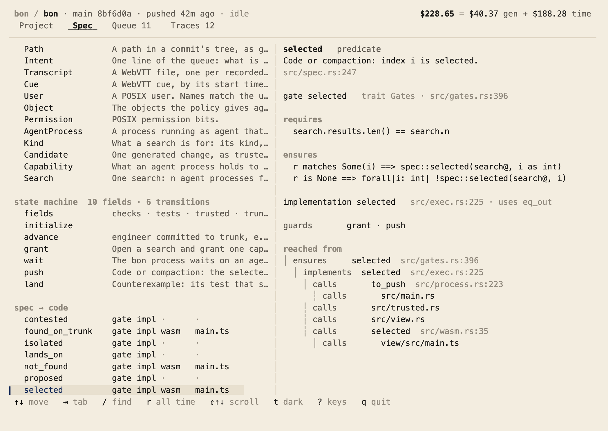

# bon

You write what the software must do. bon searches for the code: several
agent processes each write a candidate, Verus proves them, two must agree,
and blind tests try to split them before the best reaches trunk.


`bon` in a terminal shows every search, what it cost and what reached trunk:

<picture>
  <source media="(prefers-color-scheme: dark)" srcset="readme/traces-dark.png">
  
</picture>

and the spec, from its own source, down to the code that implements it:

<picture>
  <source media="(prefers-color-scheme: dark)" srcset="readme/spec-dark.png">
  
</picture>

## Start

macOS, Rust, [Verus](https://github.com/verus-lang/verus).

```sh
cargo verus build
su admin -c "target/debug/bon setup --for $USER"   # --dry-run shows each step
sudo -u agent -i codex login                         # or claude
bon code      # after a spec change: code that trunk's checks accept
bon
```

| | |
|---|---|
| `bon` | the view: Project, Spec, Queue, Traces (piped, plain text) |
| `bon code` | search for code that trunk's checks accept; push it |
| `bon counterexample` | look for a behavior on trunk the spec forbids, with tests written blind |
| `bon compaction` | remove what is stale, behavior unchanged |
| `bon queue` | turn each new transcript into a proposal for the queue |
| `bon background` | the stalest of compaction and counterexample, on spare capacity |
| `bon spec [NAME]` | the spec's vocabulary and how it reaches the code, or one item |
| `bon types [--check]` | the types programs are built on, in TypeScript, Go and Python |
| `bon sbom --check` | fail when what bon trusts changed, or a proof is skipped outside it |
| `bon check` | every check on the working tree, as candidates are judged; whose fix a failure is |
| `bon view` | the same on a page |

**You decide** the spec and the checks; the [queue](.bon/queue.tsv) holds what
is wanted and not yet in the spec. **Search decides** the rest, as the POSIX
user `agent`, which can read the checks and write only its own working
directory. Every search's record goes to a private git remote of its own,
never this repository.

## What is proven, and what is trusted

- **Proven, by Verus:** every gate returns exactly what its spec predicate says
  (`ensures r == …`), and the spec's invariants hold after every transition: every
  commit bon puts on trunk is a selected, uncontradicted candidate or a test that
  showed a forbidden behavior, and nothing spends past its limit. Specs and proofs
  are erased; the binary runs only the code they were proved about.
- **Trusted, not proven:** what bon observes: whether the tests and Verus accepted a
  candidate, what git says changed, what the harnesses cost; plus Rust's standard
  library, git, the toolchain, and Verus and Z3 themselves. It is listed in
  `.bon/sbom.json`, and no search may change it.
- **Next to Rust's types:** types keep a commit from passing as a path; Verus proves
  what a type cannot say, such as "this is the one candidate the spec selects".
- **Next to Lean:** Lean checks a proof term in a small kernel, about a model of the
  program; Verus proves the Rust that runs, trusting an SMT solver to do it.

`bon spec` shows each gate's contract as written and everything that reaches it.

## Where things are

| | |
|---|---|
| [`src/spec.rs`](src/spec.rs) | what bon is |
| [`src/gates.rs`](src/gates.rs) | each decision's contract |
| [`src/exec.rs`](src/exec.rs) | the decisions, proven |
| [`src/trusted.rs`](src/trusted.rs) | what Verus does not check; no search may change it |
| [`src/tui.rs`](src/tui.rs), [`src/projection.rs`](src/projection.rs) | the view, and what it shows as types |
| [`examples/`](examples/) | programs on the emitted types: Go, Python with PyTorch |
| [`.bon/`](.bon/) | the manifest, the queue, the SBOM |
| [`.bon/cost.toml`](.bon/cost.toml) | what reaching this trunk cost, rewritten after each push |
| [`skills/bon/`](skills/bon/SKILL.md) | how your model runs bon |
