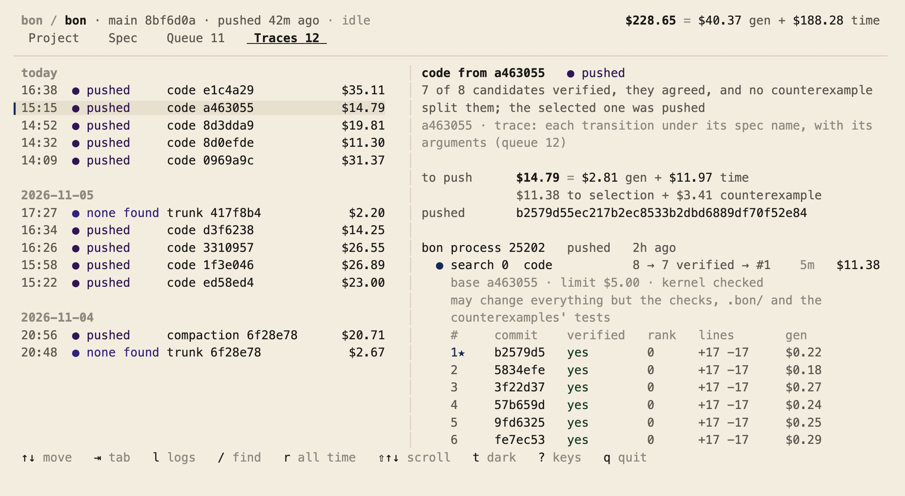
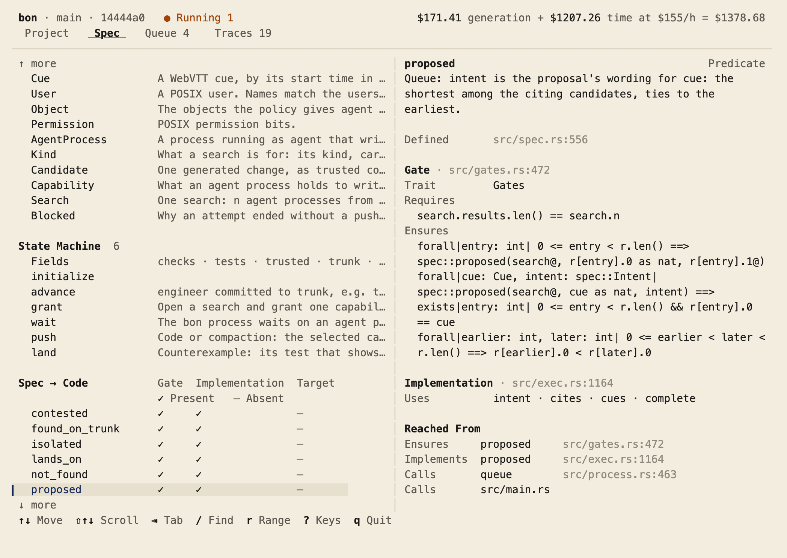

# bon

You write what the software must do. bon searches for the code: several
agent processes each write a candidate, Verus proves them, two must agree,
and blind tests try to split them before the best reaches trunk. A blind test
counts only when it rejects a foil: a program, written to break what the push
changed, that the tests accept and Verus rejects. Verified candidates that
behave differently do not block a search: blind tests decide between them, and
only when none can does it reach you, as a spec that does not decide.


`bon` in a terminal shows every search, what it cost and what reached trunk:

<picture>
  <source media="(prefers-color-scheme: dark)" srcset="assets/traces-dark.png">
  
</picture>

and the spec, from its own source, down to the code that implements it:

<picture>
  <source media="(prefers-color-scheme: dark)" srcset="assets/spec-dark.png">
  
</picture>

## Start

macOS, Rust, [Verus](https://github.com/verus-lang/verus).

```sh
cargo verus build
su admin -c "target/debug/bon setup --for $USER"   # --dry-run shows each step
sudo -u agent -i codex login                         # or claude
bon code      # after a spec change: code that trunk's checks accept
bon
```

| | |
|---|---|
| `bon [--since YYYY-MM-DD] [--until YYYY-MM-DD] [--find TEXT]` | the view: Project, Spec, Queue, Traces, over that range (piped, plain text); outside every repository, the host: what waits on you across repositories, the pools, memory, each bon process, a journal |
| `bon code` | search for code that trunk's checks accept; push it |
| `bon counterexample` | look for a behavior on trunk the spec forbids, with tests written blind |
| `bon compaction` | remove what is stale, behavior unchanged |
| `bon queue` | turn each new transcript into a proposal for the queue |
| `bon background [--plist]` | the stalest of compaction and counterexample, on spare capacity; --plist, a launchd job that runs it every five minutes |
| `bon spec [NAME]` | the spec's vocabulary and how it reaches the code, or one item |
| `bon spec <queue-id>` | a search, so it spends money: agent processes each propose a spec change that states that queue line; nothing is pushed, and it ends in a proposal you read as new words, decisions, reach and scenarios, and apply one of, or none |
| `bon types [--check]` | write the types programs are built on, in TypeScript, Go and Python, or fail if one is stale |
| `bon account [--check]` | write what is proven, trusted, configured and tested, as OSCAL with its SBOM, or fail if it is stale |
| `bon check` | every check on the working tree, as candidates are judged; whose fix a failure is; each file that breaks a rule on what a search may write |
| `bon pending [--transcript FILE]` | what only you can answer, oldest first: what happened, the choices and what each costs; outside every repository, the host's; first, each transcript dropped in the user layer's folder goes where the host file routes it |
| `bon new <name>` | set up a project: a spec with the core nouns, its gates, an empty implementation, the manifest and the queue |
| `bon init` | create a manifest and queue in this git repository |
| `bon setup [--dry-run] [--for USER]` | create users agent and check0, check1, … (one per check slot) and group bon, and let USER (default: you) run commands as each; run it as an administrator |
| `bon cost` | write .bon/cost.toml, what reaching trunk cost (bon does after each push) |
| `bon view [--state \| --frame WxH [--tab N] [--focus K] [--light]]` | the view, as bon opens it in a terminal; --state, its projection as JSON; --frame, one frame of it as HTML |
| `bon help` | every command, its arguments and what it does |

`bon <command> --help` prints that command's line and does nothing else;
`bon --version`, the version. exit: 0 done; 1 an error (one line on stderr); 2 something pending (bon pending)

**You decide** the spec and the checks; the [queue](.bon/queue.tsv) holds what
is wanted and not yet in the spec. **Search decides** the rest, as the POSIX
user `agent`, which can read the checks and write only its own working
directory; each check runs as its check slot's own user (`check0`, `check1`,
…), which writes only its own build directory. bon works on git's objects and the remote's trunk, never your
working tree: edit while it searches, and pull to follow. Every search's record
goes to a private git remote of its own, never this repository.

## The trace

Every record a bon process writes has one shape: what ran (**program**), what
it was given (**context**), what it returned (**output**), how it was judged
(**verdict**), and which **behavior** its output showed.

| record | program | context | output | verdict | behavior |
|---|---|---|---|---|---|
| an agent process, `<pid>/<search>/<index>/facts.json` | its program | `prompt`, then `+` each commit whose verdicts the prompt carries (the search's context, also its `context` line after `grant`) | its candidate's commit | `proved`, `accepted` or `rejected` | its agree outputs' hashes |
| a check, its log | `program:` its command | `context:` the tree, and any test written into it | the log's stdout and stderr | `exit:` | `behavior:` its stdout's hash |
| a decision, `decisions.jsonl` | `engineer` | what the interrupt showed | the commit that answered it | what came of it (derived) | the choice it showed |

Older traces lack some of these keys; the view reads what they recorded of
each instead. What only you can answer reaches you as an **interrupt**, which
the view derives from the traces and never stores: a queue proposal, an
attempt blocked with its width list or limit spent, or a transcript the host
file routes nowhere. It is **pending** until the action that answers it (a
commit, or the attempt run again); there is no dismiss. `bon pending` lists
them and exits 2 while any is pending; when it first sees one resolved it
writes its decision record, with a pointer to and the SHA-256 of the
transcript its `--transcript` names, never the transcript itself.

**Transcripts** you drop in the user layer's folder, `<user>/transcripts`
(`user` in the host file), go where the host file's `[routes]` send their
meeting title (a WebVTT file's header text, else its file name): each route is
a title pattern and a repository (its path under the user layer's root), and a
title matches a pattern it contains, ignoring case. When `bon pending` runs, a
transcript whose matching routes name one repository moves into that
repository's transcripts directory (the manifest's `transcripts`), not
committed: commit it to trunk, then `bon queue`. One that no route names, or
whose routes name two repositories, stays in the folder as an interrupt until
a route names it or you move it. Each route is a line of the user layer's
`.bon/traces/routes.jsonl`, in the one shape (program `route`, the transcript
as context, the repository as output, why it went nowhere as verdict).

## What is proven, and what is trusted

`bon account` prints it, from the code: every file, tool and dependency is
proven (in the kernel, verified by Verus), trusted (reviewed by the owner, not
verified), configured (a fact of the manifest) or tested (judged by the
checks), and each control bon claims names its evidence by those statuses.
[`.bon/account.json`](.bon/account.json) is the same account as an OSCAL 1.2.3
component definition mapped to NIST SP 800-53 rev 5, every claim proposed for
review, with [`.bon/sbom.json`](.bon/sbom.json) its CycloneDX bill of materials;
`bon account --check`, one of the tests, fails when either is stale. A test
checks the document against NIST's OSCAL JSON schema (its structure, required
fields and identifier formats), not the metaschema's constraints, which NIST's
`oscal-cli` validates.

`bon check` holds three rules, naming the file and the rule where one
breaks: every file a search may write is proven or read by a declared check;
no check lives in such a file; and nothing a candidate writes changes how it
is judged (no local crate with a build script or a proc macro, no unit test in
such a file, no plain Rust outside `verus!` in the kernel). The remedy for a
file no check reads is a check that reads it, or a line in `[checks] paths`;
a candidate that needs it changed then reaches you as a protected change to
review. Not enforced: a file the code takes in with `include_str!` counts as
read only if a check names it. What decides a push is checked again from
a clean build; beside it, once, run the expensive checks, `[checks] staged`,
which no other candidate runs: one that fails stops bon as a suspect check
does, and nothing is pushed. A compaction candidate's rank = its `rank`
command's integer − its suite's seconds, rounded (each test and verify check
run again once built, timed by bon, kept with the verdict, so a tree is timed
once per user layer).

- **Isolated, as the policy states and the isolated gate observes before
  every search:** each check runs as the user of the check slot it holds, in
  a build directory only that user may enter, made a fresh clone of trunk's
  kept build for it; nothing a slot's earlier check left running survives
  into its next. No agent process and no check can write another slot's
  build, trunk's kept builds, the checks' toolchain or the dependency sources
  it compiles (engineer's), or reach bon's state (the verdict cache, the
  process list), which lives in the user layer's `.bon`.
- **Trusted, and not isolated:** agent processes all run as one user, so one
  could write another's working directory, or its own build directory, which
  no check uses. The working directories are under `/tmp`, which every user
  can write (mode 1777). cargo, rustup and git each read a file discovered by
  walking a build directory's ancestors — a parent `Cargo.toml` (a
  `[workspace]`, a `[patch]`, a `[profile]`), a `.cargo/config.toml`, a
  `rust-toolchain` or `rust-toolchain.toml`, a `.git` — so a file in such an
  ancestor is a writable judge. bon closes the toolchain files by running
  every check and every agent process's cargo under `RUSTUP_TOOLCHAIN`, the
  name rustup's home has as its default, resolved once by bon where no
  toolchain file reaches it (and that name is part of the verdict key); it
  occupies each ancestor `.cargo` as its own empty directory; and before and
  after every check it refuses, or marks suspect and does not cache, any
  ancestor `Cargo.toml`, toolchain file, `.cargo` or `.git` that is not
  engineer's or root's. What stays open until the working directories move off
  `/tmp` to a root only engineer can write (`review-scratch-root.md`): because
  `/tmp` is world-writable, an agent process can still create such a file in
  the instant between a check's before-signature and its run, and a
  `Cargo.toml` is the one name bon cannot occupy in advance without breaking a
  build. Closing that fully is the scratch root's move, a reference monitor's
  job, not bon's.
  A candidate shapes its own checks' output, and a later attempt's agent
  processes read it in their prompt (a search's context): it reaches the
  generators, never how anything is judged or selected, and never a
  counterexample's or a foil's writer (the spec's `blind`).
- **Trusted: what "the spec stands alone" means.** For a spec search, bon
  makes, from git objects alone, a crate of the spec's files (the check
  paths that are Rust with a `verus!` block) with the manifest's package,
  dependencies, lints and lockfile, and a `lib.rs` declaring those files and
  nothing else; Verus on that crate is what proves a spec candidate. The same
  files make the same crate, and a trunk whose spec does not verify in it is
  refused before anything is reserved.
- **Next to Rust's types:** types keep a commit from passing as a path; Verus proves
  what a type cannot say, such as "this is the one candidate the spec selects".
- **Next to Lean:** Lean checks a proof term in a small kernel, about a model of the
  program; Verus proves the Rust that runs, trusting an SMT solver to do it.

`bon spec` shows each gate's contract as written and everything that reaches it.

## Where things are

| | |
|---|---|
| [`src/spec.rs`](src/spec.rs) | what bon is |
| [`src/gates.rs`](src/gates.rs) | each decision's contract |
| [`src/exec.rs`](src/exec.rs) | the decisions, proven |
| [`src/trusted.rs`](src/trusted.rs) | what Verus does not check; no search may change it |
| [`src/tui.rs`](src/tui.rs), [`src/projection.rs`](src/projection.rs), [`src/interrupt.rs`](src/interrupt.rs), [`src/host.rs`](src/host.rs), [`src/route.rs`](src/route.rs) | the view, what it shows as types, what waits on you, the host, and where transcripts go |
| [`template/`](template/) | the project `bon new` sets up |
| [`examples/`](examples/) | programs on the emitted types: TypeScript, Go, Python with PyTorch |
| [`.bon/`](.bon/) | the manifest, the queue, the account and its SBOM |
| [`.bon/cost.toml`](.bon/cost.toml) | what reaching this trunk cost, rewritten after each push |
| [`skills/bon/`](skills/bon/SKILL.md) | how your model runs bon |
